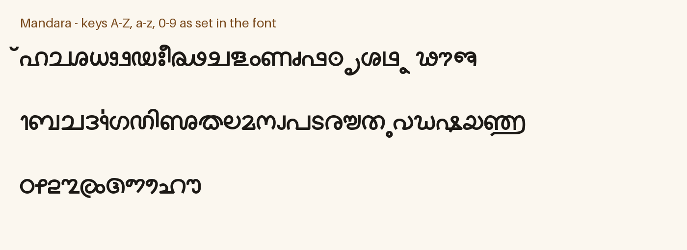

<h1 align="center">Mandara</h1>
<p align="center"><em>A bold, rounded Tulu lipi font.</em></p>



Mandara is a compact Tulu lipi font with a bold, rounded stroke, as the specimen shows. Its logo is below.

| | |
|---|---|
| **Designer** | Prahlad Prasad Tantry |
| **Format** | TrueType, `.ttf` |
| **Glyphs** | 158 |
| **Year** | 2021 |
| **License** | [SIL OFL 1.1](OFL.txt) |
| **Family** | [Tantry Tulu Font Foundry](https://github.com/TantryTuluFonts) |

## Get the font

Download the latest build from the [Releases page](https://github.com/TantryTuluFonts/mandara/releases/latest), or take `fonts/XmMdar(mandara)v1(RL).ttf` straight from this repository.

- **Windows:** right-click the file and choose *Install for all users*.
- **macOS:** open the file and click *Install Font*.
- **Linux:** copy it to `~/.local/share/fonts/` and run `fc-cache -f`.

## How to type with Mandara

Mandara is key-mapped: it places Tulu lipi glyphs on the Latin keys, so you type with an ordinary keyboard and the font draws the Tulu forms. The specimen above shows what each key produces. Because the text is stored as Latin characters, it only reads as Tulu while Mandara is applied; paste it somewhere with a different font and it will show as plain Latin letters. Keep that in mind for search, sharing and archiving.

Mandara follows the **AccTantra** typing standard, the shared key map for all the ASCII fonts in the Tantry family. See the [key map](https://github.com/TantryTuluFonts/AccTantra/blob/main/docs/KEYMAP.md), the [conjunct reference](https://github.com/TantryTuluFonts/AccTantra/blob/main/docs/CONJUNCTS.md) and the [typing examples](https://github.com/TantryTuluFonts/AccTantra/blob/main/docs/EXAMPLES.md). Try it: type `EAamA nEma narayNay` and Mandara shows *Om namo Narayanaya*.

<p align="center"></p>

## Use on the web

```css
@font-face {
  font-family: "Mandara";
  src: url("fonts/XmMdar(mandara)v1(RL).ttf");
  font-display: swap;
}
.tulu { font-family: "Mandara", sans-serif; }
```

## License and credit

Mandara is free software under the [SIL Open Font License 1.1](OFL.txt): use it in print, on screens or in products, study it, and make your own versions, as long as the font is not sold on its own and derivatives stay under the same license. Please keep the credit **Prahlad Prasad Tantry** when you share it. Full history is in the [FONTLOG](FONTLOG.md).

Questions or specimens to show off? [Open an issue](https://github.com/TantryTuluFonts/mandara/issues).
